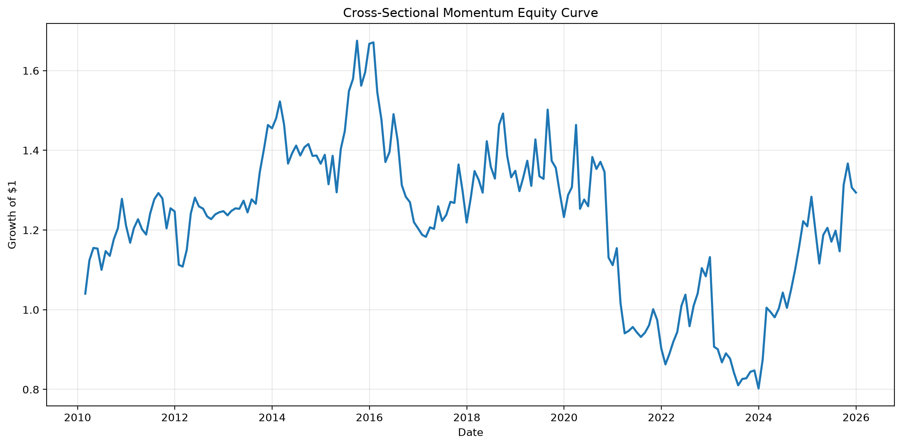
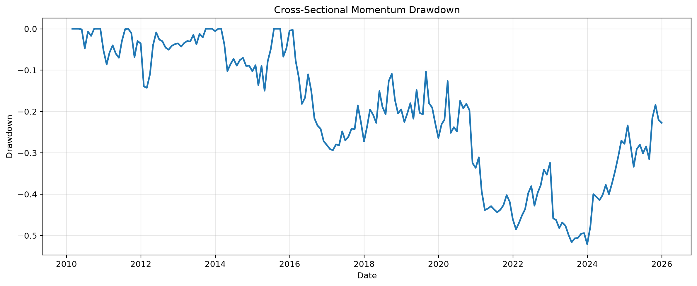
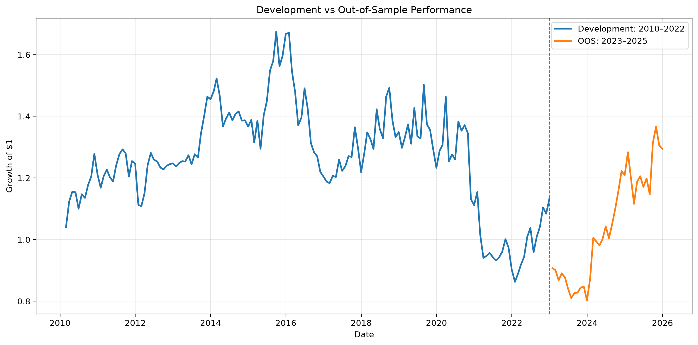
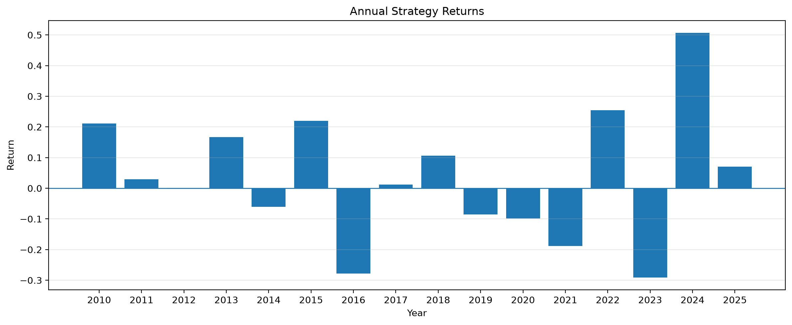

# Cross-Sectional Momentum in US Equities

This project explores whether a stock's relative past performance can provide information about its future returns.

I implemented a simple cross-sectional momentum strategy on S&P 500 stocks and evaluated it using historical data. The main goal was not to build a production trading system, but to understand how a systematic strategy is designed, backtested, and evaluated, including issues such as look-ahead bias, transaction costs, survivorship bias, and out-of-sample testing.

---

## Research Question

> Does cross-sectional equity momentum generate persistent market-neutral alpha after transaction costs and across different time periods and signal specifications?

The basic idea behind the strategy is simple:

- Rank stocks based on their past returns.

- Buy the stocks that performed relatively well.

- Short the stocks that performed relatively poorly.

- Rebalance the portfolio every month.

- Study whether this relative performance persists into the following month.

---

## What I Wanted to Learn

This project was primarily a learning exercise in quantitative research and systematic strategy development.

Some of the questions I wanted to understand were:

- How can a momentum signal be constructed without using future information?

- How should a long-short portfolio be constructed from a cross-sectional ranking?

- How much does performance change with different momentum lookback periods?

- How important are transaction costs?

- Does a strategy that looks reasonable over a long historical period also perform on data that was not used during development?

- How much can the results vary across different market periods?

---

## Data

I used the current constituents of the **S&P 500** as the stock universe.

Historical price data was obtained using `yfinance`.

The data covers approximately:

- **2009–2025** for the downloaded price history

- **2010–2025** for the main backtest

I used adjusted prices through `yfinance` with `auto_adjust=True`.

---

## Strategy

### Momentum Signal

The main signal is **12–1 month momentum**.

For each stock at the end of a month, I calculate:

$$

Momentum_t =

\frac{P_{t-1}}{P_{t-12}} - 1

$$

where:

- $P_{t-1}$ is the price at the previous month-end

- $P_{t-12}$ is the price approximately twelve months earlier

The most recent month is excluded from the calculation.

For example, when forming the portfolio at the end of December, the signal uses information available through November rather than December's return.

This creates a one-month gap between the end of the lookback period and portfolio formation.

---

## Portfolio Construction

At each monthly rebalance:

- Rank all stocks with sufficient historical data by their momentum signal.

- Buy the top **10%** of stocks.

- Short the bottom **10%**.

- Equal-weight stocks within each side.

- Allocate +100% to the long side.

- Allocate -100% to the short side.

This gives approximately:

- **0% net exposure**

- **200% gross exposure**

The portfolio formed at the end of month \(t\) is held during month \(t+1\).

This lag is important because it prevents future information from entering the backtest.

---

## Backtesting Process

The backtest was implemented using monthly data.

For each rebalance date:

1. Calculate the momentum signal.

2. Remove stocks without a valid signal.

3. Rank the remaining stocks.

4. Select the top and bottom 10%.

5. Construct equal-weight long and short positions.

6. Calculate the returns of those positions during the following month.

7. Repeat for every month in the backtest.

When some stocks did not have a valid return during a holding period, the long and short sides were renormalized separately so that the portfolio maintained its intended exposure.

---

# Results

## Full-Sample Performance

The baseline 12–1 momentum strategy produced the following results over 2010–2025:

| Metric | Result |

|---|---:|

| Annualized Return | **1.63%** |

| Annualized Volatility | **17.78%** |

| Sharpe Ratio | **0.1807** |

| Maximum Drawdown | **-52.10%** |

### Equity Curve



### Drawdown



The strategy had a relatively modest long-run return and experienced a large maximum drawdown. This was useful for understanding that a market-neutral strategy is not necessarily a low-risk strategy.

---

# Robustness Tests

After implementing the baseline strategy, I tested whether the results changed substantially when some of the strategy parameters were changed.

## 1. Momentum Lookback

I compared three different lookback specifications:

- 3–1 months

- 6–1 months

- 12–1 months

| Lookback | Ann. Return | Volatility | Sharpe | Max Drawdown |

|---|---:|---:|---:|---:|

| 3–1 | -3.96% | 15.76% | -0.1776 | -53.42% |

| 6–1 | -0.02% | 16.64% | 0.0822 | -37.44% |

| 12–1 | 1.63% | 17.78% | 0.1807 | -52.10% |

The results were quite sensitive to the lookback period. The 12–1 month specification performed better in this sample, but the results do not suggest that momentum works equally well across all lookback periods.

---

## 2. Portfolio Breadth

I also changed the fraction of stocks selected for the long and short portfolios.

| Portfolio Breadth | Ann. Return | Volatility | Sharpe | Max Drawdown |

|---|---:|---:|---:|---:|

| Top/Bottom 5% | 4.30% | 23.05% | 0.2998 | -55.60% |

| Top/Bottom 10% | 1.63% | 17.78% | 0.1807 | -52.10% |

| Top/Bottom 20% | 1.61% | 13.70% | 0.1854 | -36.57% |

The more concentrated portfolio had higher returns but also higher volatility and drawdown.

The 20% specification reduced risk substantially, although its Sharpe ratio was similar to the baseline.

---

# Transaction Costs

One of the things I wanted to understand was how much of the backtest performance could disappear once trading costs were considered.

The baseline strategy had approximately **55.99% average monthly turnover**.

I tested several simple transaction-cost assumptions.

| Transaction Cost | Ann. Return | Volatility | Sharpe | Max Drawdown |

|---|---:|---:|---:|---:|

| Gross | 1.63% | 17.78% | 0.1807 | -52.10% |

| 10 bps | 1.02% | 17.83% | 0.1469 | -54.75% |

| 25 bps | 0.00% | 17.84% | 0.0903 | -58.46% |

| 50 bps | -1.67% | 17.86% | -0.0039 | -63.98% |

This was one of the more important findings from the project.

The gross return looks positive, but the full-sample result becomes much weaker as transaction costs increase.

This showed me why evaluating a trading strategy only using its gross backtest return can be misleading.

---

# Out-of-Sample Testing

I split the data into two periods:

### Development Period

**2010–2022**

This period was used for developing and investigating the strategy.

### Out-of-Sample Period

**2023–2025**

The strategy specification was then evaluated on this later period.



### OOS Results

| Metric | OOS 2023–2025 |

|---|---:|

| Annualized Return | **4.56%** |

| Annualized Volatility | **21.68%** |

| Sharpe Ratio | **0.3134** |

| Maximum Drawdown | **-13.06%** |

The OOS period produced a higher annualized return than the full-sample result.

However, the OOS period contains only **36 monthly observations**, so I do not consider this sufficient evidence by itself to establish persistent alpha.

---

## OOS Transaction Costs

| Transaction Cost | Ann. Return | Volatility | Sharpe | Max Drawdown |

|---|---:|---:|---:|---:|

| Gross | 4.56% | 21.68% | 0.3134 | -13.06% |

| 10 bps | 3.90% | 21.68% | 0.2840 | -13.15% |

| 25 bps | 2.91% | 21.68% | 0.2399 | -13.28% |

| 50 bps | 1.28% | 21.67% | 0.1664 | -14.38% |

The OOS return remained positive under the tested transaction-cost assumptions, although the sample is short.

---

# Statistical Analysis

I also tested whether the average monthly OOS return was statistically distinguishable from zero.

The OOS period contained 36 monthly observations.

| Statistic | Result |

|---|---:|

| Mean Monthly Return | 0.57% |

| Monthly Standard Deviation | 6.26% |

| Standard Error | 1.04% |

| t-statistic | 0.5427 |

| p-value | 0.5907 |

| 95% Confidence Interval | [-1.55%, 2.68%] |

The confidence interval includes zero and the p-value is relatively large.

Therefore, based on this 36-month OOS sample, I cannot conclude that the mean monthly return is statistically different from zero.

I found this result useful because it highlighted the difference between **having a positive backtest** and having statistically strong evidence for a persistent return effect.

---

# Subperiod Analysis

To understand whether the strategy behaved consistently over time, I divided the backtest into three periods.

| Period | Ann. Return | Volatility | Sharpe | Max Drawdown |

|---|---:|---:|---:|---:|

| 2010–2015 | 9.02% | 13.22% | 0.7214 | -14.98% |

| 2016–2020 | -7.79% | 20.14% | -0.3014 | -33.46% |

| 2021–2025 | 3.08% | 19.84% | 0.2528 | -30.50% |

The results vary substantially across the three periods.

The strategy performed strongly during 2010–2015, had a negative period during 2016–2020, and produced more modest positive returns during 2021–2025.

This suggests that momentum performance can be sensitive to the market environment.



---

# Autocorrelation

I also looked at autocorrelation in the monthly strategy returns.

For the full sample:

| Lag | Autocorrelation |

|---:|---:|

| 1 | -0.0642 |

| 3 | -0.0222 |

| 6 | 0.0750 |

| 12 | 0.0690 |

For the OOS period:

| Lag | Autocorrelation |

|---:|---:|

| 1 | 0.0290 |

| 3 | 0.0308 |

| 6 | 0.0048 |

| 12 | -0.2338 |

Short-term autocorrelation was relatively small. The 12-month OOS estimate was more negative, but it is difficult to draw a strong conclusion from only 36 OOS observations.

---

# What I Learned

This project helped me understand several parts of systematic quantitative research that are easy to overlook when first learning about backtesting.

### 1. Avoiding look-ahead bias

A signal can easily become unrealistic if information from the future accidentally enters portfolio construction.

I therefore separated signal formation from the period over which the portfolio earned returns.

### 2. A positive backtest is not enough

The baseline strategy produced positive gross returns, but the result became much weaker after transaction costs.

This made implementation assumptions an important part of the analysis rather than an afterthought.

### 3. Parameter sensitivity matters

Changing the momentum lookback from 12–1 months to 3–1 months produced very different results.

This made me more cautious about interpreting one particular parameter choice as evidence of a general effect.

### 4. Out-of-sample testing matters

The OOS period gave me a way to evaluate the strategy on data that was not part of the development period.

At the same time, the relatively short OOS sample showed why a positive OOS result should not automatically be interpreted as strong statistical evidence.

### 5. Market-neutral does not mean risk-free

Even though the portfolio is approximately dollar-neutral, the strategy experienced a maximum drawdown of approximately 52% over the full sample.

---

# Limitations

## Survivorship Bias

The biggest limitation of the dataset is that I used **today's S&P 500 constituents historically**.

Companies that were previously part of the index but later left it are therefore missing from the historical universe.

A true point-in-time constituent dataset would be preferable for a production-quality study.

## Transaction Costs

The transaction-cost model is deliberately simple.

The analysis does not explicitly model:

- Bid-ask spreads

- Market impact

- Borrow costs

- Short-sale constraints

- Financing costs

- Taxes

- Delisting returns

## Data Source

The historical prices were obtained through Yahoo Finance rather than an institutional market-data provider.

## OOS Sample Size

The OOS period contains only 36 monthly observations, which limits the statistical power of the analysis.

---

# Conclusion

This project started with a simple question: **can relative past performance of stocks be used to construct a systematic long-short strategy?**

The 12–1 month momentum strategy produced a positive gross return over the historical sample, but the results were sensitive to transaction costs, momentum lookback, portfolio breadth, and market period.

The held-out 2023–2025 period also produced positive returns, but the relatively small OOS sample did not provide statistically significant evidence that the mean monthly return was different from zero.

The main takeaway for me was therefore not that I had demonstrated a robust trading strategy, but that building a quantitative strategy requires much more than finding a positive backtest. Signal construction, timing, costs, robustness, statistical testing, and out-of-sample evaluation all materially affect the conclusions.

---

# Project Structure

All of the analysis is currently contained in a single Jupyter notebook.

```text

cross-sectional-momentum/

│

├── main.ipynb

│

├── results/

│   ├── equity_curve.png

│   ├── drawdown.png

│   ├── annual_returns.png

│   └── development_vs_oos.png

│

├── README.md

├── requirements.txt

└── .gitignore